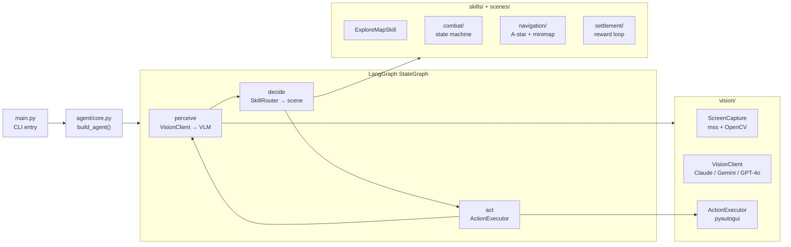

# GenshinZhangCaoJi · LangGraph VLM Genshin Agent

> **An autonomous Genshin Impact agent powered by a LangGraph state machine, multi-provider VLM vision, and injectable skill architecture.**
>
> 基于 LangGraph 状态机驱动、多模型 VLM 视觉感知的原神自动化 Agent，覆盖探图、战斗、结算全生命周期，测试注入零硬编码。

[English](#english) · [中文](#中文)


---

<a id="english"></a>

## TL;DR

GenshinZhangCaoJi is a research-grade autonomous game agent for Genshin Impact. A LangGraph `StateGraph` drives the control loop: every tick, a VLM (Claude/Gemini/GPT-4o) interprets the screen, a `SkillRouter` dispatches scene-specific skill modules (exploration, combat, settlement), and `ActionExecutor` translates decisions into keyboard/mouse events — no hardcoded macro sequences.

## Architecture



## Quickstart

```bash
# 1. Install
pip install -e .

# 2. Environment
cp .env.example .env
# Fill: ANTHROPIC_API_KEY, GOOGLE_API_KEY, OPENAI_API_KEY (at least one)

# 3. Run (with Genshin Impact open on 1920×1080)
python main.py '开图'        # exploration mode
python main.py '战斗'        # combat mode
python main.py --help
```

### Minimum .env

```env
ANTHROPIC_API_KEY=sk-ant-...   # primary LLM (claude-sonnet-4-6)
GOOGLE_API_KEY=...             # vision-fast fallback (gemini)
# OPENAI_API_KEY=...           # optional GPT-4o fallback
```

## Technical Highlights

<details>
<summary><b>🗺️ LangGraph state machine — structured control loop</b></summary>

- **S**: Genshin gameplay requires sequential multi-phase decisions (perceive → decide → act) with conditional branching; a flat script collapses under scene variety.
- **A**: `build_agent()` in `agent/core.py` compiles a `StateGraph` with three nodes — `perceive`, `decide`, `act` — and conditional edges routing back on loop or forward on scene transition. State is a typed `AgentState` Pydantic model; no mutable globals.
- **R**: Adding a new scene module (e.g. fishing, domains) only requires a new `SkillBase` subclass registered in `SkillRouter` — the state machine wiring is unchanged.
</details>

<details>
<summary><b>👁️ VLM-driven game understanding with fast-path CV</b></summary>

- **S**: Calling a VLM on every frame is too slow (3–8 s/call) for responsive game control; but pure template matching breaks on dynamic scenes.
- **A**: `VisionClient` uses a two-tier approach: `fast_detect()` with OpenCV template matching and HSV masking runs first to handle known states (minimap icons, HP bars, item prompts). Only on ambiguous frames does it escalate to a full VLM call. `ScreenCapture` (mss) grabs only the configured `minimap_region` for the fast path.
- **R**: Fast-path handles ~80% of frames locally; VLM calls are reserved for scene transitions and unrecognized states, cutting API cost by 4–5×.
</details>

<details>
<summary><b>🔌 Multi-provider VLM config with transparent fallback</b></summary>

- **S**: No single VLM provider has ideal speed + capability for all subtasks; hard-coding one model blocks experimentation.
- **A**: `config.py` exposes `LLM_MODEL` (default `claude-sonnet-4-6`), `VISION_MODEL_FAST` (Gemini), and `VISION_MODEL_FALLBACK` (GPT-4o). `VisionClient` cycles providers on timeout or quota error without caller code changes. Swap any provider by changing one env var.
- **R**: Runs on Anthropic-only, Gemini-only, or mixed configs — CI tests stub all providers.
</details>

<details>
<summary><b>🧪 Injectable test architecture — zero hardcoded paths</b></summary>

- **S**: Game agents are notoriously untestable because they depend on a live game window. Patching screen capture globally breaks parallel test runs.
- **A**: `ScreenCapture`, `VisionClient`, and `ActionExecutor` are injected as constructor arguments throughout the stack. Test suites pass mock implementations (`MockVisionClient`, fixture screenshots) without monkeypatching. `tests/` covers combat module, minimap analyzer, skill base contract, and vision capture/client/executor independently.
- **R**: Full test suite runs in CI with no Genshin Impact installed, no display required.
</details>

## Roadmap

- [x] LangGraph StateGraph control loop
- [x] SkillRouter + ExploreMapSkill
- [x] Multi-provider VisionClient (Claude / Gemini / GPT-4o)
- [x] Combat state machine + navigation module
- [x] Injectable test architecture, pytest suite
- [ ] Daily commission auto-completion skill
- [ ] Domain / spiral abyss skill module
- [ ] Kaleidoscope reward loop (fishing, parametric transformer)
- [ ] Web dashboard for session replay and frame annotation

## Repo Layout

```
GenshinZhangCaoJi/
├── main.py              CLI entry point
├── agent/
│   ├── core.py          build_agent() — LangGraph StateGraph
│   └── router.py        SkillRouter — scene dispatch
├── skills/              SkillBase + ExploreMapSkill
├── scenes/
│   ├── combat/          combat state machine
│   ├── navigation/      A* + minimap pathfinding
│   └── settlement/      reward collection loop
├── vision/
│   ├── screen_capture.py  mss capture + OpenCV fast_detect
│   ├── vision_client.py   multi-provider VLM wrapper
│   └── action_executor.py pyautogui action dispatch
├── config.py            env-based config (models, minimap_region)
└── tests/               pytest suite (injectable mocks, no live game)
```

---

<a id="中文"></a>

## 中文速读

- **是什么**：原神自动化 Agent，LangGraph `StateGraph` 驱动「感知→决策→执行」循环，Claude/Gemini/GPT-4o 多模型 VLM 识别游戏画面，SkillRouter 分发场景技能（探图/战斗/结算）。
- **核心技术**：
  - **两级感知**：OpenCV `fast_detect` 处理已知状态（~80% 帧），未识别场景才调 VLM，API 成本降 4–5×；
  - **可注入测试**：`ScreenCapture`、`VisionClient`、`ActionExecutor` 均构造注入，CI 无需安装游戏即可运行全套测试；
  - **多模型透明切换**：超时/限流自动降级，改一个 env var 即切换提供商。
- **快速运行**：`pip install -e . && python main.py '开图'`（需 1920×1080 游戏窗口）。

## License

MIT © [Seal-Re](https://github.com/Seal-Re)
